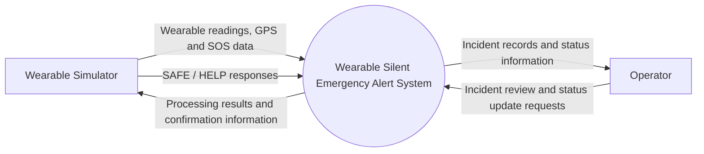
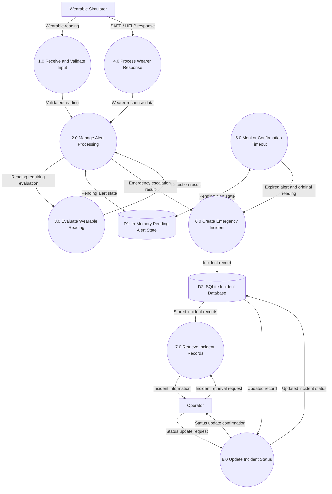
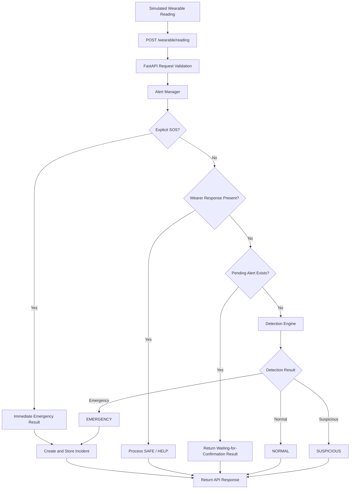
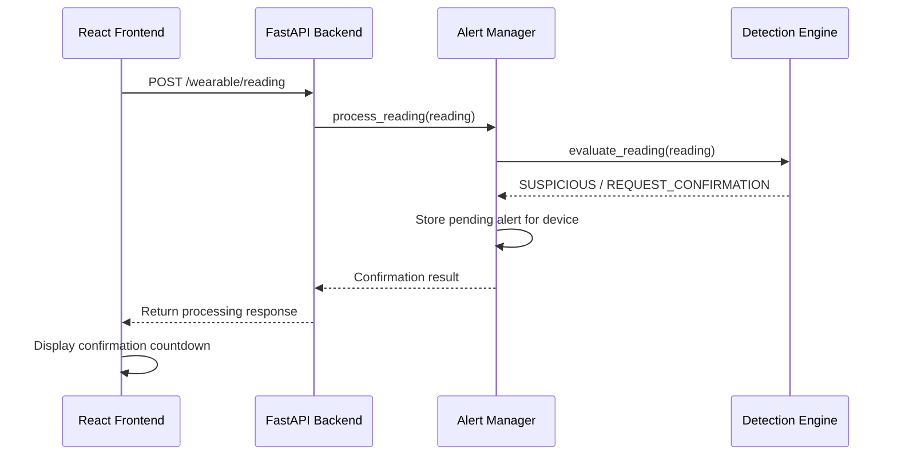
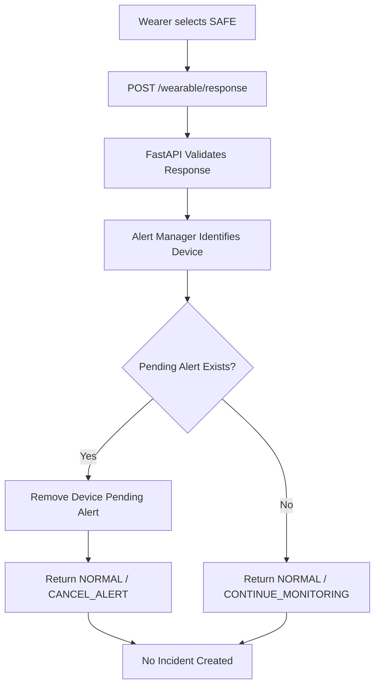
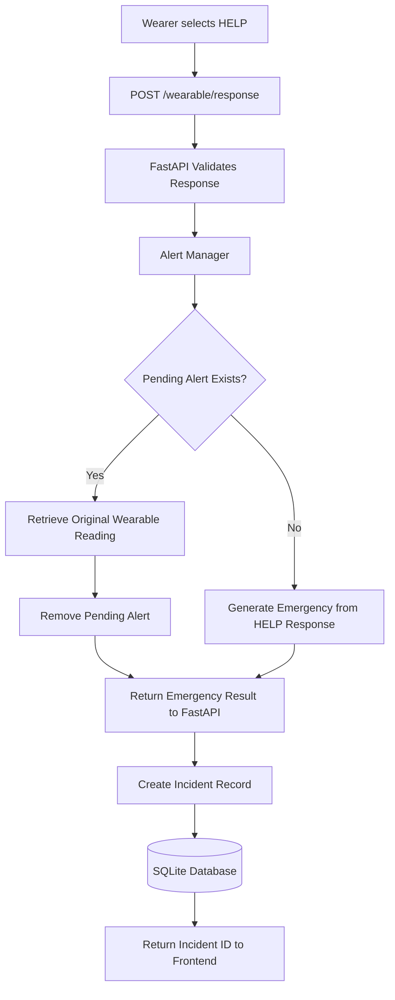
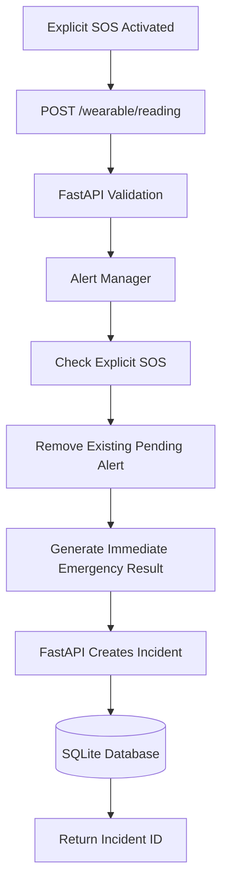
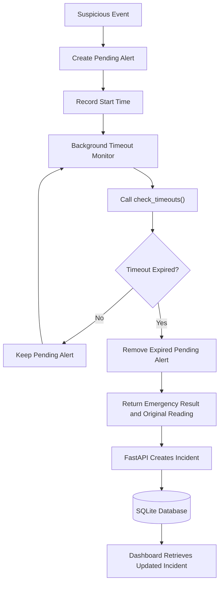
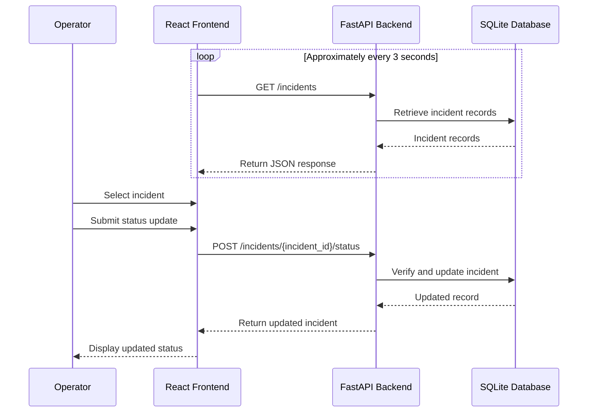
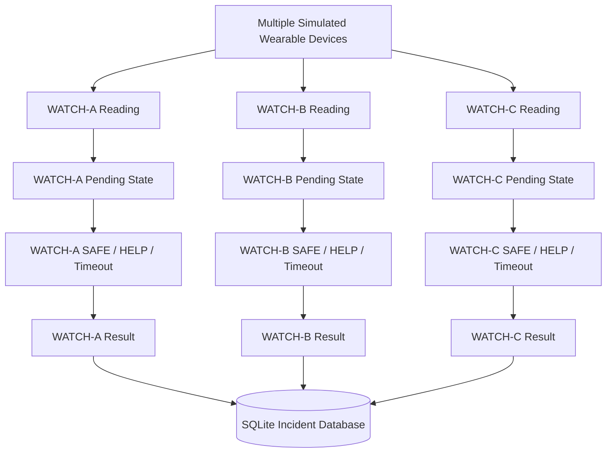

# Wearable Silent Emergency Alert Band
## Data Flow Diagram (DFD)

**Project Name:** Wearable Silent Emergency Alert Band  
**Document:** Data Flow Diagram  
**Version:** 1.1  
**Project Stage:** Software Simulation Prototype

---

## 1. Introduction

This document describes how data flows through the Wearable Silent Emergency Alert Band software prototype.

The system receives simulated wearable readings, processes them through a rule-based detection engine and alert manager, requests wearer confirmation when suspicious conditions are identified, and generates emergency incidents when escalation is required.

The data flow includes:

- Wearable reading submission and validation.
- Rule-based detection.
- Pending-alert creation and management.
- SAFE and HELP response processing.
- Explicit SOS handling.
- Automatic confirmation timeout escalation.
- Incident creation and database storage.
- Incident retrieval and status management through the dashboard.

The prototype currently operates in simulation mode. Wearable sensor readings and GPS coordinates are simulated. No physical wearable hardware or real emergency-service communication is implemented.

## 2. Main Data Flow Components

| Component | Responsibility |
|---|---|
| Wearable Scenario Simulator | Generates simulated sensor readings, SOS events and wearer responses |
| React Dashboard | Displays confirmation information and incident records |
| FastAPI Backend | Receives requests, validates input, coordinates processing and manages incidents |
| Detection Engine | Evaluates wearable readings using predefined rules |
| Alert Manager | Maintains pending alerts and handles escalation decisions |
| Confirmation Timeout Monitor | Checks pending alerts for expiration |
| SQLite Database | Stores emergency incident records |
| Operator | Reviews incidents and submits status updates |

### 2.1 Main Data Stores

The system uses two different storage mechanisms.

| Data Store | Storage Type | Contents |
|---|---|---|
| Pending Alert State | In-memory Python dictionary | Device ID, start time, original reading and alert reason |
| Incident Database | SQLite | Persisted emergency incident records and statuses |

Pending confirmations are temporary application state. Emergency incidents are persisted in the SQLite database.

## 3. Level 0 DFD — Context Diagram

The Level 0 DFD represents the entire application as a single system and illustrates its interactions with external entities.

### 3.1 External Entities

**1. Wearable Simulator**

The simulator provides:

- Simulated heart-rate readings.
- Gesture detection status.
- Explicit SOS activation.
- Synthetic GPS coordinates.
- SAFE and HELP responses.

The simulator is part of the React frontend.

**2. Operator**

The operator interacts with the dashboard to:

- View the incident queue.
- Review incident details.
- Inspect available location information.
- Submit incident status updates.

### 3.2 Context Diagram

The system receives simulated wearable data and wearer responses, processes potential emergency conditions, stores generated incidents, and provides incident information to the operator.

## 4. Level 1 DFD — Detailed System Data Flow

The Level 1 DFD breaks the application into its major internal processing components.

### 4.1 Processing Stages

1. Receive and validate incoming wearable data.
2. Process readings through the Alert Manager.
3. Evaluate eligible readings through the Detection Engine.
4. Maintain pending confirmation states.
5. Process SAFE and HELP responses.
6. Monitor pending confirmations for timeout expiration.
7. Create and persist emergency incidents.
8. Retrieve incidents for the dashboard.
9. Update incident statuses.

### 4.2 Level 1 Diagram

**Implementation clarification:**

- Process 2 represents the Alert Manager's decision-making role.
- Process 3 represents the Detection Engine.
- Process 4 represents the FastAPI wearer-response endpoint forwarding the response to the Alert Manager.
- Process 5 represents the background timeout-monitoring task.
- Process 6 represents incident creation and persistence through the FastAPI application.
- The pending-alert state is maintained in application memory.
- Incident records are persisted in SQLite.
- The Alert Manager does not access SQLite directly. The FastAPI application performs incident storage.

## 5. Detailed Data Flow — Wearable Reading

The wearable reading process begins when the simulator submits a reading to the backend.

### 5.1 Input Data

The `POST /wearable/reading` endpoint accepts the following fields:

| Field | Data Type | Description |
|---|---|---|
| `device_id` | String | Identifier of the simulated wearable |
| `heart_rate_bpm` | Integer or null | Heart-rate value in BPM |
| `gesture_detected` | Boolean | Indicates whether a gesture was detected |
| `acknowledged` | Boolean or null | Optional acknowledgement value used by detection rules |
| `explicit_sos` | Boolean | Indicates explicit SOS activation |
| `latitude` | Float or null | Latitude coordinate |
| `longitude` | Float or null | Longitude coordinate |
| `location_accuracy_m` | Float or null | Location accuracy in metres |
| `wearer_response` | String or null | Optional SAFE or HELP response |

SAFE and HELP can also be submitted separately through the `POST /wearable/response` endpoint.

**Validation details:**

- The API model accepts integer heart-rate values from 0 to 250 BPM.
- The Detection Engine accepts heart-rate values from 25 to 240 BPM.
- Latitude must be between -90 and 90.
- Longitude must be between -180 and 180.
- Location accuracy must be non-negative when supplied.
- The wearable reading endpoint additionally checks that `wearer_response` is either null, SAFE or HELP.

### 5.2 Processing Flow

1. The simulator sends a POST request to `/wearable/reading`.
2. FastAPI validates the incoming request.
3. The backend converts the request into a reading dictionary.
4. The Alert Manager receives the reading.
5. The Alert Manager checks explicit SOS first.
6. If explicit SOS is not activated, it checks wearer-response and pending-alert conditions.
7. If the reading requires normal detection evaluation, the Alert Manager invokes the Detection Engine.
8. The Detection Engine returns a classification and recommended action.
9. The Alert Manager determines the final processing result.
10. The backend stores an incident if the result requires emergency escalation.
11. The backend returns the processing result to the frontend.

### 5.3 Reading Processing Diagram

**Important:** When a device already has a pending confirmation, ordinary new readings from that same device are not re-evaluated by the Detection Engine. The Alert Manager returns a waiting-for-confirmation result instead.

A NORMAL result does not create an emergency incident. A SUSPICIOUS result creates a pending confirmation. An emergency result is passed to the backend for incident creation.

## 6. Detailed Data Flow — Detection and Suspicious Event

The Detection Engine evaluates eligible readings using predefined rules.

### 6.1 Detection Conditions

| Condition | Detection Result | Action |
|---|---|---|
| Normal heart rate without gesture | NORMAL | CONTINUE_MONITORING |
| High heart rate alone (≥120 BPM) | NORMAL | CONTINUE_MONITORING |
| Gesture detected without high heart rate | SUSPICIOUS | REQUEST_CONFIRMATION |
| Gesture and high heart rate, acknowledgement missing | SUSPICIOUS | REQUEST_CONFIRMATION |
| Gesture and high heart rate, acknowledgement false | EMERGENCY | SEND_EMERGENCY_ALERT |
| Gesture and high heart rate, acknowledgement true | NORMAL | CONTINUE_MONITORING |

Explicit SOS is intercepted by the Alert Manager before the Detection Engine is invoked in the normal API reading flow.

The heart-rate thresholds are demonstration rules and are not clinically validated.

### 6.2 Suspicious Event Processing

1. A simulated wearable reading is received.
2. The Alert Manager determines that no immediate SOS or pending-alert condition applies.
3. The Detection Engine evaluates the reading.
4. The Detection Engine returns `SUSPICIOUS` with `REQUEST_CONFIRMATION`.
5. The Alert Manager creates a pending alert for the corresponding device.
6. The pending alert stores the device ID, start time, original reading and reason.
7. The backend returns the processing result.
8. The frontend displays a confirmation countdown.

### 6.3 Suspicious Event Sequence Diagram

The backend owns the pending confirmation state. The frontend countdown is only a visual representation of the confirmation period.

## 7. Detailed Data Flow — SAFE Response

A SAFE response indicates that the wearer confirms they do not require emergency assistance.

### 7.1 Processing Steps

1. The simulator submits a SAFE response.
2. The frontend sends a POST request to `/wearable/response`.
3. FastAPI validates the request.
4. The backend forwards the response and device ID to the Alert Manager.
5. The Alert Manager checks for a pending alert belonging to that device.
6. If a pending alert exists, it is removed.
7. The Alert Manager returns `NORMAL / CANCEL_ALERT`.
8. If no pending alert exists, it returns `NORMAL / CONTINUE_MONITORING`.
9. The backend returns the result to the frontend.

### 7.2 SAFE Response Diagram

The SAFE response only affects the pending alert associated with the responding device.

Pending alerts belonging to other devices remain unaffected.

## 8. Detailed Data Flow — HELP Response

A HELP response represents an explicit request for emergency assistance.

### 8.1 Processing Steps

1. The simulator submits a HELP response.
2. The frontend sends a POST request to `/wearable/response`.
3. FastAPI validates the response.
4. The backend forwards the response and device ID to the Alert Manager.
5. The Alert Manager identifies the corresponding device.
6. If a pending alert exists, the Alert Manager retrieves the original wearable reading.
7. The pending alert is removed.
8. An emergency result is generated.
9. If no pending alert exists, the HELP response itself generates an emergency result using the available response reading.
10. The backend receives the emergency result.
11. The backend creates and stores the incident in SQLite.
12. The API returns the incident identifier and processing result.

### 8.2 HELP Response Diagram

**Important implementation detail:**

The Alert Manager processes HELP directly. It does not invoke the Detection Engine for this response.

When a pending alert exists, the original reading is used for incident creation. Without a pending alert, the response reading is used. Location information is therefore included only when it is available in the relevant reading.

## 9. Detailed Data Flow — Explicit SOS

Explicit SOS represents an immediate emergency request.

### 9.1 Processing Steps

1. The simulator activates explicit SOS.
2. The frontend submits the wearable reading to `/wearable/reading`.
3. FastAPI validates the reading.
4. The Alert Manager checks the explicit SOS field before other processing.
5. Any pending alert belonging to the same device is removed.
6. The Alert Manager generates an immediate emergency result.
7. The backend receives the result and original reading.
8. The backend creates and stores the incident in SQLite.
9. The API returns the incident identifier and processing result.
10. The dashboard retrieves the incident.

### 9.2 Explicit SOS Diagram

Explicit SOS bypasses the confirmation process. It does not wait for the 15-second timeout.

## 10. Detailed Data Flow — Automatic Timeout Escalation

The automatic timeout mechanism operates independently of new wearable readings and wearer responses.

The backend runs a background asynchronous task that checks pending confirmations approximately once every second.

The configured confirmation timeout is 15 seconds.

### 10.1 Processing Steps

1. A suspicious event creates a pending alert.
2. The Alert Manager records the confirmation start time.
3. The background monitor calls `check_timeouts()`.
4. The Alert Manager checks the elapsed time for each pending alert.
5. If the timeout has not expired, the pending alert remains active.
6. If the timeout has expired, the Alert Manager removes the pending alert.
7. The Alert Manager returns an emergency result containing the original wearable reading.
8. The background monitor receives the result.
9. The FastAPI application creates and stores the emergency incident.
10. The frontend retrieves the updated incident list through its periodic API requests.

### 10.2 Timeout Escalation Diagram

Each expired pending alert is removed before its emergency result is returned. This prevents repeated escalation of the same expired alert during subsequent monitoring cycles.

The timeout monitor does not write to SQLite directly. It uses the incident-storage logic in the FastAPI application.

## 11. Detailed Data Flow — Incident Management

When an emergency result is generated, the FastAPI application creates an incident record and stores it in SQLite.

The React dashboard retrieves the stored records through the backend API.

### 11.1 Incident Creation

The backend creates an incident containing:

- Unique incident ID.
- UTC creation timestamp.
- Device ID.
- Alert level.
- Incident status.
- Escalation reason.
- Heart-rate value, when available.
- Latitude and longitude, when available.
- Location accuracy, when available.
- Delivery status.

The initial incident status is `OPEN`.

The delivery status defaults to `SIMULATED`.

### 11.2 Incident Retrieval

1. The React frontend sends a GET request to `/incidents`.
2. FastAPI retrieves incident records from SQLite.
3. The backend returns the records as JSON.
4. The React dashboard displays the incident queue.
5. The frontend refreshes the incident list approximately every three seconds.

The frontend uses the retrieved incident list to display incident details. It does not need to query SQLite directly.

### 11.3 Incident Status Update

1. The operator selects an incident.
2. The operator selects a status update action.
3. The frontend sends a POST request to `/incidents/{incident_id}/status`.
4. FastAPI verifies that the incident exists.
5. The backend updates the incident status in SQLite.
6. The updated incident is returned to the frontend.
7. The dashboard displays the updated status.

The backend accepts the four permitted status values but does not enforce the intended transition order. The dashboard applies the intended status progression through its controls.

### 11.4 Incident Management Sequence Diagram

## 12. Multi-Device Data Flow

The Alert Manager supports multiple simulated wearable devices.

Each device maintains its own pending confirmation state, identified by its device ID.

### 12.1 Example

| Device | Event | Result |
|---|---|---|
| WATCH-A | Suspicious gesture | Confirmation requested |
| WATCH-B | Gesture and high heart rate | Confirmation requested |
| WATCH-A | SAFE | WATCH-A pending alert cancelled |
| WATCH-B | HELP | WATCH-B alert escalated |
| WATCH-C | No response for 15 seconds | WATCH-C alert escalated |

The Alert Manager uses device identifiers to isolate pending alerts.

A response from one device does not cancel or escalate another device's pending alert.

### 12.2 Multi-Device Diagram

**Frontend limitation:**

The backend supports independent pending alerts for multiple devices. However, the current frontend simulator displays only one active confirmation countdown at a time. Backend multi-device support should not be confused with simultaneous countdown visualization in the dashboard.

## 13. Data Storage and Database Structure

The prototype uses two separate storage mechanisms for different purposes.

### 13.1 In-Memory Pending Alert State

The Alert Manager maintains pending confirmation information in an in-memory Python dictionary.

Each pending alert contains:

| Field | Description |
|---|---|
| Device ID | Identifies the wearable device |
| Started At | Monotonic start time of the confirmation period |
| Reason | Reason for requesting confirmation |
| Original Reading | Wearable reading associated with the suspicious event |

Pending state is removed when:

- The wearer responds SAFE.
- The wearer responds HELP.
- The confirmation timeout expires.
- An explicit SOS event is received for the same device.

Pending confirmation state is not persisted across backend restarts.

### 13.2 Persistent Incident Database

The application uses SQLite to store emergency incidents.

The `incidents` table contains the following columns:

| Column | Data Type | Description |
|---|---|---|
| `incident_id` | TEXT PRIMARY KEY | Unique incident identifier |
| `created_at` | TEXT NOT NULL | UTC incident creation timestamp |
| `device_id` | TEXT | Wearable device identifier |
| `alert_level` | TEXT NOT NULL | Incident alert classification |
| `status` | TEXT NOT NULL | Current incident status |
| `reason` | TEXT | Reason for escalation |
| `heart_rate_bpm` | INTEGER | Heart-rate value, when available |
| `latitude` | REAL | Latitude, when available |
| `longitude` | REAL | Longitude, when available |
| `location_accuracy_m` | REAL | Location accuracy, when available |
| `delivery_status` | TEXT NOT NULL DEFAULT 'SIMULATED' | Incident delivery status |

The database file is:

`backend/incidents.db`

### 13.3 Storage Behaviour

Pending confirmations and emergency incidents have different storage lifecycles.

Pending alerts are maintained temporarily in application memory and are lost when the backend process restarts.

Emergency incident records are persisted in SQLite and normally remain available after a backend restart, provided the database file is retained.

This separation allows the system to manage active confirmation processes in memory while maintaining a persistent history of generated incidents.

## 14. Data Flow Summary

The following diagram summarizes the complete emergency-processing workflow.

START
  |
  v
Incoming Wearable Reading
  |
  v
Pending Alert Exists?
  |
  +---------------- YES ----------------------+
  |                                           |
  NO                                          v
  |                              Confirmation Timeout Expired?
  v                                           |
Evaluate Reading                   +----------+----------+
  |                                |                     |
  v                               YES                   NO
Detection Result                   |                     |
  |                                v                     v
  |                       Remove Pending Alert    SUSPICIOUS:
  |                                |               Waiting for
  |                                |               Confirmation
  |                                |
  |                                |
  |                                +------------
  +---- NORMAL -----> Continue Monitoring      |
  |                                            |
  +---- SUSPICIOUS                             |
  |        |                                   |
  |        v                                   |
  |   Request Wearer Confirmation              |
  |        |                                   |
  |        v                                   |
  |   Store Pending Alert                      |
  |        |                                   |
  |        v                                   |
  |   Start 15-Second Timer                    |
  |        |                                   |
  |        v                                   |
  |   Wearer Response                          |
  |        |                                   |
  |        +----------+-------------+          |
  |        |          |             |          |
  |       SAFE    No Response      HELP        |
  |        |          |             |          |
  |        v          v             |          |
  |   Cancel       Timeout          |          |
  |   Pending      Monitor          |          |
  |   Alert          |              |          |
  |                  v              |          |
  |          15 Seconds Expired?    |          |
  |                  |              |          |
  |             +----+----+         |          |
  |             |         |         |          |
  |            NO        YES        |          |
  |             |         |         |          |
  |             v         v         |          |
  |          Timeout   Remove       |          |
  |          Monitor   Pending      |          |
  |                    Alert        |          |
  |                      |          |          |
  |                      v          |          |
  +---------------- Generate Emergency Alert   |
  |                                            |                    
  +---- EMERGENCY -----------------------------+
                                               |
                                               v
                                  Generate Emergency Alert
                                               |
                                               v
                                  Store Incident in SQLite
                                               |
                                               v
                                  Delivery Status: SIMULATED
                                               |
                                               v
                                              END

## 15. Important Implementation Limitations

The following limitations apply to the current implementation:

1. Wearable readings are generated through a software simulator.
2. Physical wearable sensors are not connected.
3. Detection uses predefined rules rather than a trained machine-learning model.
4. Heart-rate thresholds are demonstration rules and are not clinically validated.
5. GPS coordinates used by the simulator are synthetic.
6. Pending confirmation state is maintained in memory and is not restored after backend restarts.
7. The timeout monitor operates within the backend application process.
8. The frontend polls the backend for incident updates rather than using WebSockets.
9. The frontend displays one active confirmation countdown at a time.
10. Incident status transition order is not enforced by the backend.
11. Emergency delivery is simulated.
12. No actual SMS, phone call, police notification, ambulance request or emergency-service dispatch is implemented.

## 16. Conclusion

The Data Flow Diagram demonstrates how the Wearable Silent Emergency Alert Band prototype processes simulated wearable readings and manages potential emergency situations.

The system separates request validation, detection, alert management, wearer confirmation, timeout monitoring and incident persistence into distinct processing responsibilities.

It supports normal monitoring, suspicious-event confirmation, SAFE and HELP responses, explicit SOS activation, automatic timeout escalation, multi-device pending-alert management and incident tracking through a web dashboard.

The current implementation provides a software foundation for future integration with physical wearable hardware, real sensor acquisition, and external emergency communication services.