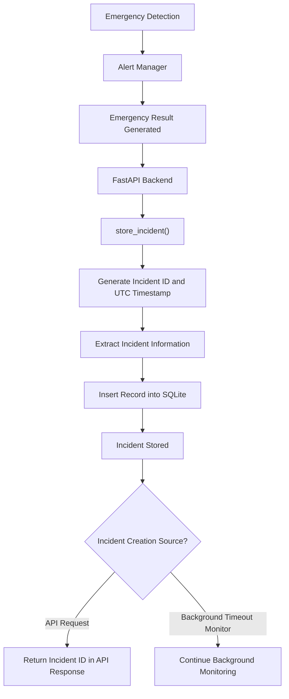

# Database Design – Wearable Silent Emergency Alert Band

**Document Version:** 1.0  
**Project:** Wearable Silent Emergency Alert Band  
**Database:** SQLite  
**Backend:** Python – FastAPI

---

## 1. Introduction

The Wearable Silent Emergency Alert Band uses an SQLite database to store emergency incidents generated by the backend alert management system.

The database maintains incident information such as:

- Unique incident identification.
- Incident creation timestamp.
- Wearable device identification.
- Alert severity level.
- Incident status.
- Reason for emergency detection.
- Heart rate at the time of the incident.
- GPS coordinates and location accuracy.
- Simulated alert delivery status.

The database provides persistent storage for incident records so that the dashboard can retrieve and display previously generated incidents.

The current implementation uses a single database table named `incidents`.

## 2. Database Technology

| Component | Implementation |
|---|---|
| Database engine | SQLite |
| Database library | Python `sqlite3` |
| Database file | `incidents.db` |
| Database location | Backend directory |
| Primary table | `incidents` |
| Primary key | `incident_id` |

### 2.1 Database File Location

The database path is defined in `database.py`:

```python
DB_PATH = Path(__file__).resolve().parent / "incidents.db"
```

This ensures that the database file is created in the same directory as `database.py`, rather than depending on the directory from which the application is executed.

### 2.2 Database Connection

The backend uses Python's built-in SQLite library.

The `get_connection()` function:

- Opens a connection to the SQLite database.
- Configures the connection to return rows as `sqlite3.Row` objects.
- Allows database records to be accessed using column names.

## 3. Database Schema

The current database contains one table:

**Table Name:** `incidents`

This table stores emergency incident records generated by the alert management system.

### 3.1 Entity Structure

```text
                  INCIDENTS
        ┌──────────────────────────────┐
        │ PK  incident_id             │
        │     created_at              │
        │     device_id               │
        │     alert_level             │
        │     status                  │
        │     reason                  │
        │     heart_rate_bpm          │
        │     latitude                │
        │     longitude               │
        │     location_accuracy_m     │
        │     delivery_status         │
        └──────────────────────────────┘
```

**PK:** Primary Key

### 3.2 Table Definition

The following table describes the actual SQLite schema.

| Column | Data Type | Constraints | Description |
|---|---|---|---|
| incident_id | TEXT | PRIMARY KEY | Unique identifier for each incident |
| created_at | TEXT | NOT NULL | UTC timestamp when the incident was created |
| device_id | TEXT | — | Identifier of the wearable device |
| alert_level | TEXT | NOT NULL | Severity level of the incident |
| status | TEXT | NOT NULL | Current incident management status |
| reason | TEXT | — | Explanation for why the incident was generated |
| heart_rate_bpm | INTEGER | — | Heart rate associated with the incident |
| latitude | REAL | — | GPS latitude coordinate |
| longitude | REAL | — | GPS longitude coordinate |
| location_accuracy_m | REAL | — | GPS location accuracy in metres |
| delivery_status | TEXT | NOT NULL, DEFAULT 'SIMULATED' | Indicates simulated alert delivery |

A dash (—) indicates that no explicit constraint is defined for that column in the current schema.

### 3.3 SQL Table Creation

The following SQL represents the table definition implemented in `database.py`.

```sql
CREATE TABLE IF NOT EXISTS incidents (
    incident_id TEXT PRIMARY KEY,
    created_at TEXT NOT NULL,
    device_id TEXT,
    alert_level TEXT NOT NULL,
    status TEXT NOT NULL,
    reason TEXT,
    heart_rate_bpm INTEGER,
    latitude REAL,
    longitude REAL,
    location_accuracy_m REAL,
    delivery_status TEXT NOT NULL DEFAULT 'SIMULATED'
);
```

## 4. Description of Database Fields

### 4.1 Incident Identification

**incident_id**

- Stores a unique identifier for each incident.
- Uses TEXT as its data type.
- Acts as the primary key.
- Generated using Python's UUID functionality.

**created_at**

- Stores the date and time when the incident record is created.
- Uses TEXT to store an ISO-formatted UTC timestamp.
- The timestamp is generated by the backend.

### 4.2 Device Information

**device_id**

- Identifies the wearable device associated with the incident.
- Uses TEXT as its data type.
- Defaults to `WATCH-001` when the backend does not receive a device identifier.

This field supports the handling of incidents from multiple simulated wearable devices.

### 4.3 Alert Information

**alert_level**

Stores the severity level associated with the incident.

The detection system defines three alert levels:

- NORMAL
- SUSPICIOUS
- EMERGENCY

Emergency incident records generated through the current alert escalation flow normally use the EMERGENCY level.

**status**

Represents the incident's management status.

The backend supports the following values:

| Status | Description |
|---|---|
| OPEN | Incident has been created and is awaiting operator action |
| ACKNOWLEDGED | Incident has been acknowledged by the operator |
| DISPATCHED_SIMULATED | Simulated dispatch action has been recorded |
| CLOSED | Incident has been marked as closed |

These values describe the incident management workflow in the simulation.

**reason**

Stores the explanation for the emergency event.

Examples include:

- Explicit SOS activated.
- Wearer requested help.
- Confirmation timeout expired.

### 4.4 Health Information

**heart_rate_bpm**

- Stores the heart rate in beats per minute.
- Uses INTEGER as its data type.
- Can be NULL if the heart rate is unavailable.

This information helps preserve the heart rate reading associated with an emergency incident.

### 4.5 Location Information

The database contains three location-related fields.

| Field | Purpose |
|---|---|
| latitude | Geographic latitude of the incident |
| longitude | Geographic longitude of the incident |
| location_accuracy_m | Estimated GPS accuracy in metres |

Latitude and longitude use the REAL data type.

These fields are nullable because an emergency alert can be generated even when GPS coordinates are unavailable.

For example, the SOS Without GPS simulation creates an incident without location coordinates.

### 4.6 Alert Delivery Information

The database schema defines **SIMULATED** as the default value. Additionally, the backend's **store_incident()** function explicitly assigns this value when creating an incident record. It indicates that emergency alert delivery is simulated rather than connected to real emergency services.

## 5. Database Initialization

The database is initialized through the `initialize_database()` function in `database.py`.

During application startup:

1. The FastAPI application executes its lifespan initialization.
2. The database initialization function is called.
3. The `incidents` table is created if it does not already exist.
4. The application begins accepting requests.

The SQL statement uses `CREATE TABLE IF NOT EXISTS`, so an existing table is not recreated unnecessarily.

## 6. Incident Data Storage Process

Incident records are inserted into the database through the `store_incident()` function in `main.py`.

### 6.1 Incident Creation Flow



### 6.2 Stored Information

When an emergency incident is generated, the backend collects the relevant information from the reading and alert result.

The backend inserts the following information:

- Incident ID.
- Creation timestamp.
- Device ID.
- Alert level.
- Incident status.
- Emergency reason.
- Heart rate.
- GPS latitude.
- GPS longitude.
- Location accuracy.
- Delivery status.

The incident is initially assigned the `OPEN` status, and its delivery status defaults to `SIMULATED`.

## 7. Incident Retrieval

The backend provides API endpoints to retrieve stored incident information.

### 7.1 Retrieve All Incidents

**Endpoint:**

```http
GET /incidents
```

Functionality:

- Retrieves all incident records from SQLite.
- Sorts records by `created_at` in descending order.
- Returns the newest incidents first.

### 7.2 Retrieve a Specific Incident

**Endpoint:**

```http
GET /incidents/{incident_id}
```

Functionality:

- Searches for an incident using its unique ID.
- Returns the corresponding incident record if found.
- Returns HTTP 404 if the incident does not exist.

## 8. Incident Status Management

The backend allows an operator to update the status of an existing incident.

**Endpoint:**

```http
POST /incidents/{incident_id}/status
```

Supported status values:

- OPEN
- ACKNOWLEDGED
- DISPATCHED_SIMULATED
- CLOSED

The backend first checks whether the incident exists and then updates its status in SQLite.

**Implementation detail:** The backend validates the status value but does not enforce a mandatory sequence of status transitions. The dashboard applies additional restrictions through its interface controls.

## 9. Persistent Storage and In-Memory Data

The system uses two different storage mechanisms.

### 9.1 Persistent Storage – SQLite

SQLite stores emergency incident records after the alert management system determines that an emergency should be generated. The records can initially have an OPEN status and remain stored even after the backend application restarts, provided the database file is retained.

### 9.2 In-Memory Storage – Alert Manager

Pending confirmation alerts are maintained in the `AlertManager` Python object using an in-memory dictionary.

This dictionary stores:

- Alert start time.
- Reason for requesting confirmation.
- Original wearable reading.

Pending confirmation states are not stored in SQLite.

Consequently, pending alerts are lost if the backend process restarts before confirmation or timeout escalation occurs.

### 9.3 Storage Comparison

| Information | Storage Mechanism | Survives Backend Restart? |
|---|---|---|
| Emergency incident records | SQLite | Yes, if database file is retained |
| Pending confirmation alerts | Python memory | No |
| Incident status updates | SQLite | Yes, if database file is retained |

## 10. Database Relationships

The current implementation contains only one database table.

Therefore:

- No foreign keys are currently defined.
- No relationships between multiple tables are implemented.
- Each incident record independently stores its associated device ID and incident information.

The `device_id` field identifies the source device, but it does not currently reference a separate device table.

## 11. Database Limitations

The current database is designed for a simulation prototype.

Its limitations include:

1. Only one table is currently implemented.
2. Pending confirmation states are not persistent.
3. No separate wearable device registration table exists.
4. No user profile table is implemented.
5. No database-level foreign key relationships are defined.
6. No explicit indexes beyond the primary key are created.
7. Alert delivery is simulated; no real emergency notification delivery is recorded.
8. The database does not currently maintain a separate history of every status transition.

These limitations reflect the current implementation and do not prevent the existing incident management workflow from functioning.

## 12. Future Database Enhancements

The database can be extended in future development phases.

Possible enhancements include:

- A `devices` table for wearable device registration.
- A `users` table for wearer information.
- A separate `sensor_readings` table for historical sensor data.
- An `alert_history` table for tracking alert events.
- An `incident_status_history` table for maintaining status transition records.
- Persistent storage of pending confirmation states.
- Appropriate indexes for frequently queried fields.
- Database migration support as the schema evolves.

These are proposed improvements and are not part of the current implementation.

## 13. Conclusion

The current Wearable Silent Emergency Alert Band prototype uses SQLite to maintain persistent emergency incident records.

The `incidents` table stores the essential information required for incident identification, monitoring, location reference, and operator status management.

The backend combines persistent SQLite storage with in-memory alert confirmation management to implement the emergency alert workflow.

This database design provides the storage foundation for the current simulation prototype while allowing future expansion to support physical wearable devices and more advanced emergency management features.