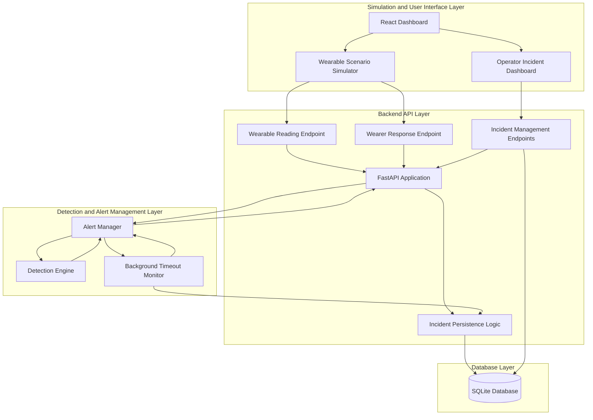

# Wearable Silent Emergency Alert Band
## System Architecture Document

**Project Name:** Wearable Silent Emergency Alert Band  
**Document:** System Architecture  
**Version:** 1.1  
**Project Stage:** Software Simulation Prototype

---

## 1. Introduction

The Wearable Silent Emergency Alert Band is a software simulation prototype designed to demonstrate a wearable-based emergency detection and alert-management system.

The system simulates wearable sensor readings, evaluates incoming data using predefined rule-based detection logic, requests wearer confirmation when suspicious conditions are identified, and escalates alerts when necessary.

The prototype supports multiple simulated wearable devices, with each device maintaining an independent pending-alert state and confirmation process.

The system consists of a React-based monitoring dashboard, a Python FastAPI backend, a rule-based detection engine, an alert manager, a background confirmation timeout monitor, and an SQLite database.

**Important:** The current implementation is a software simulation prototype. It does not include physical wearable sensors, real emergency notifications, or communication with actual emergency services.

## 2. System Objectives

The primary objectives are:

1. Simulate wearable sensor readings.
2. Identify potentially suspicious conditions using predefined detection rules.
3. Request wearer confirmation when suspicious activity is detected.
4. Allow the wearer to respond with SAFE or HELP.
5. Automatically escalate pending alerts when the confirmation period expires.
6. Support immediate emergency triggering through an explicit SOS action.
7. Maintain independent pending-alert states for multiple simulated wearable devices.
8. Store generated emergency incidents in a persistent database.
9. Provide a dashboard for monitoring and managing emergency incidents.
10. Clearly distinguish simulated emergency operations from actual emergency-service communication.

## 3. High-Level Architecture

The system follows a client-server architecture and is organized into four primary layers:

- Simulation and User Interface Layer
- Backend API Layer
- Detection and Alert Management Layer
- Database Layer

Each layer performs a specific responsibility while communicating with the other layers through defined interfaces.

### 3.1 Architecture Diagram

**Architecture clarification:**

- The React dashboard communicates with the FastAPI backend through HTTP requests.
- The backend forwards wearable readings and wearer responses to the Alert Manager.
- The Alert Manager invokes the Detection Engine when a new reading needs evaluation.
- The Detection Engine returns its classification and recommended action to the Alert Manager.
- The Alert Manager returns the resulting decision to the backend.
- The backend handles incident creation and database persistence.
- The background timeout monitor independently checks pending alerts and sends expired alerts through the incident persistence logic.
- The incident management endpoints retrieve and update records in SQLite.

## 4. Technology Stack

| Component | Technology | Responsibility |
|---|---|---|
| Frontend | React 19 | User interface |
| Programming Language | TypeScript | Frontend development |
| Frontend Build Tool | Vite | Development server and production builds |
| Backend Language | Python | Application logic |
| Backend Framework | FastAPI | REST API development |
| Data Validation | Pydantic | Request validation |
| Database | SQLite | Incident persistence |
| API Communication | HTTP / JSON | Frontend-backend communication |
| Testing | Pytest | Backend automated testing |
| Styling | CSS | Dashboard presentation |

## 5. Component Architecture

### 5.1 Simulation and User Interface Layer

The frontend provides the interface for simulating wearable activity and monitoring emergency incidents.

**Primary responsibilities:**

- Select a simulated wearable device.
- Generate normal and suspicious sensor scenarios.
- Trigger an explicit SOS event.
- Simulate SAFE and HELP responses.
- Display confirmation countdowns.
- Retrieve and display incident records.
- Display individual incident details.
- Allow operators to update incident statuses.
- Display simulated incident locations when coordinates are available.

**Main files:**

- `frontend/src/App.tsx`
- `frontend/src/App.css`
- `frontend/src/index.css`

The frontend communicates with the backend through HTTP requests using the Fetch API.

The simulator provides synthetic sensor readings and GPS coordinates. These values are used to demonstrate the software workflow and do not represent actual wearable sensor measurements.

The frontend displays one active confirmation countdown at a time, even though the backend supports independent pending confirmations for multiple devices.

### 5.2 Backend API Layer

The backend provides the communication interface between the frontend and the internal processing components.

It is implemented using FastAPI.

**Primary responsibilities:**

- Receive simulated wearable readings.
- Receive wearer responses.
- Validate incoming request data.
- Forward readings and responses to the Alert Manager.
- Return processing results to the frontend.
- Generate and store emergency incidents.
- Retrieve incident records.
- Update incident statuses.
- Run the background confirmation timeout monitor.

**Main file:**

`backend/main.py`

The backend also initializes the SQLite database and manages the lifecycle of the background timeout-monitoring task.

### 5.3 Detection Engine

The Detection Engine evaluates incoming wearable readings using predefined rule-based conditions.

It classifies readings into three alert levels:

- NORMAL
- SUSPICIOUS
- EMERGENCY

**Inputs considered:**

- Heart rate in beats per minute.
- Gesture detection.
- Explicit SOS activation.
- Wearer acknowledgement.

**Detection Rules**

The current implementation follows these rules:

| Condition | Detection Engine Result |
|---|---|
| Normal heart rate without gesture | NORMAL / CONTINUE_MONITORING |
| High heart rate alone (≥120 BPM) | NORMAL / CONTINUE_MONITORING |
| Gesture detected without high heart rate | SUSPICIOUS / REQUEST_CONFIRMATION |
| Gesture + high heart rate, acknowledgement missing | SUSPICIOUS / REQUEST_CONFIRMATION |
| Gesture + high heart rate, acknowledgement false | EMERGENCY / SEND_EMERGENCY_ALERT |
| Gesture + high heart rate, acknowledgement true | NORMAL / CONTINUE_MONITORING |

Explicit SOS is also supported by the detection logic. However, during normal API processing, the Alert Manager intercepts explicit SOS before the Detection Engine is invoked and escalates it immediately.

**Heart-rate validation:**

- The API request model accepts integer heart-rate values from 0 to 250 BPM.
- The Detection Engine accepts values from 25 to 240 BPM.
- Therefore, values accepted by the API may still be rejected by the Detection Engine.

A high heart rate alone does not automatically generate an emergency incident.

The detection logic is rule-based and does not currently use a trained machine-learning model.

**Main file:**

`backend/detection_engine.py`

### 5.4 Alert Manager

The Alert Manager controls the lifecycle of pending emergency confirmations.

It maintains independent pending-alert states using individual wearable device identifiers.

**Primary responsibilities:**

- Maintain pending confirmation requests.
- Record confirmation start times.
- Process SAFE responses.
- Process HELP responses.
- Escalate explicit SOS events immediately.
- Escalate alerts when the confirmation timeout expires.
- Preserve the original wearable reading associated with an escalated alert.
- Prevent repeated escalation of the same expired alert.
- Maintain independent alert states for multiple devices.

**Pending Alert Behaviour**

When a suspicious event is detected, the Alert Manager creates a pending confirmation for the corresponding device.

While that device has an active pending confirmation, subsequent ordinary sensor readings from the same device are not evaluated again by the Detection Engine. The Alert Manager instead returns a waiting-for-confirmation result with the remaining confirmation time.

The pending alert must be resolved or expire before ordinary readings from that device are evaluated again.

**Wearer response handling:**

- **SAFE with a pending alert:** The pending alert is removed and the system returns a NORMAL result with a CANCEL_ALERT action.
- **SAFE without a pending alert:** The system returns NORMAL with CONTINUE_MONITORING.
- **HELP with a pending alert:** The pending alert is removed and escalated using the original pending wearable reading.
- **HELP without a pending alert:** An emergency is generated using the incoming response reading.

**Explicit SOS handling:**

An explicit SOS event is processed immediately. It removes any existing pending alert for the same device and returns an emergency result without waiting for wearer confirmation.

**Thread safety:**

The Alert Manager uses a reentrant lock (`RLock`) to protect access to shared pending-alert state.

**Configuration:**

- Default device ID: `WATCH-001`
- Confirmation timeout: 15 seconds

**Main file:**

`backend/alert_manager.py`

### 5.5 Confirmation Timeout Monitor

The Confirmation Timeout Monitor is a background asynchronous task implemented in the FastAPI application.

It periodically checks pending confirmations maintained by the Alert Manager.

**Processing sequence:**

1. The monitor calls the Alert Manager's `check_timeouts()` method.
2. The Alert Manager checks the elapsed time for each pending confirmation.
3. Expired pending alerts are removed from the pending-alert collection.
4. Emergency results are returned with their original wearable readings.
5. The backend processes the results and stores the corresponding incidents in SQLite.
6. The monitor repeats the process after approximately one second.

This mechanism allows an alert to be escalated even when no additional sensor reading or wearer response is received.

The monitor runs independently of frontend countdown displays. The frontend countdown is a visual representation; the backend performs the actual timeout checking and escalation.

**Implementation location:**

`backend/main.py`

### 5.6 Database Layer

SQLite is used for persistent incident storage.

The database stores emergency incident information generated by the backend.

**Primary responsibilities:**

- Initialize the incident database.
- Create incident records.
- Retrieve all incident records.
- Retrieve individual incidents.
- Update incident statuses.

**Database file:**

`backend/incidents.db`

**Main file:**

`backend/database.py`

The database is accessed through the backend database module and is not accessed directly by the frontend.

## 6. Alert Processing Architecture

The system supports five major alert-processing scenarios.

### 6.1 Normal Condition

1. The simulator generates a normal wearable reading.
2. The frontend submits the reading to the backend.
3. The backend forwards the reading to the Alert Manager.
4. The Alert Manager invokes the Detection Engine when no pending alert blocks ordinary evaluation.
5. The Detection Engine classifies the reading as NORMAL.
6. The backend returns the processing result.
7. No emergency incident is generated.

### 6.2 Suspicious Condition

1. The simulator generates a suspicious wearable reading.
2. The backend receives the reading.
3. The Alert Manager forwards it to the Detection Engine.
4. The Detection Engine identifies a suspicious condition.
5. The Alert Manager creates a pending confirmation for the corresponding device.
6. The system requests wearer confirmation.
7. The confirmation countdown is displayed by the frontend.

### 6.3 SAFE and HELP Responses

**SAFE response:**

1. The wearer responds with SAFE.
2. The frontend submits the response to the backend.
3. The backend forwards the response to the Alert Manager.
4. If a pending alert exists for that device, it is removed.
5. The system returns a NORMAL result with a cancellation action.
6. No emergency incident is created for the cancelled alert.

If no pending alert exists, SAFE returns a normal monitoring result without changing another device's alert state.

**HELP response:**

1. The wearer responds with HELP.
2. The frontend submits the response to the backend.
3. The backend forwards the response to the Alert Manager.
4. If a pending alert exists, it is removed and escalated.
5. The original wearable reading is preserved for incident creation.
6. If no pending alert exists, the HELP response itself is treated as an emergency request.
7. The backend creates and stores the incident in SQLite.

### 6.4 Automatic Timeout Escalation

1. A suspicious event creates a pending confirmation.
2. The Alert Manager records the confirmation start time.
3. The background monitor periodically checks pending alerts.
4. The wearer does not respond within the configured 15-second timeout.
5. The Alert Manager identifies the expired confirmation.
6. The pending state is removed to prevent repeated escalation.
7. The emergency result and original wearable reading are returned to the backend.
8. The backend creates and stores the incident.
9. The frontend retrieves the updated incident list through its periodic API requests.

### 6.5 Explicit SOS

1. The simulator triggers an explicit SOS event.
2. The frontend submits the reading to the backend.
3. The Alert Manager receives the reading.
4. The Alert Manager checks explicit SOS before normal detection processing.
5. Any existing pending confirmation for that device is removed.
6. An emergency result is returned immediately.
7. The backend stores the incident in SQLite.
8. The frontend retrieves and displays the new incident.

Explicit SOS does not require the confirmation timeout to expire.

## 7. Incident Lifecycle

An emergency incident can have one of the following statuses:

| Status | Description |
|---|---|
| OPEN | Incident has been created and is awaiting operator action. |
| ACKNOWLEDGED | Operator has acknowledged the incident. |
| DISPATCHED_SIMULATED | A simulated dispatch action has been recorded. |
| CLOSED | Incident has been marked as closed. |

These statuses represent actions within the software prototype.

The dashboard provides controls that guide operators through the intended status progression.

However, the backend status-update endpoint accepts any of the four permitted status values without enforcing a particular transition sequence. The progression restrictions are therefore enforced by the dashboard interface rather than by the backend API.

The incident delivery status is stored as `SIMULATED`.

No actual emergency service, police department, ambulance service, or external responder is contacted.

## 8. API Architecture

The backend exposes the following REST API endpoints:

| Method | Endpoint | Purpose |
|---|---|---|
| GET | `/health` | Check backend availability and simulation mode |
| POST | `/wearable/reading` | Submit wearable sensor readings |
| POST | `/wearable/response` | Submit SAFE or HELP response |
| GET | `/incidents` | Retrieve all incident records |
| GET | `/incidents/{incident_id}` | Retrieve a specific incident |
| POST | `/incidents/{incident_id}/status` | Update incident status |

The frontend uses these endpoints to communicate with the backend.

The backend validates incoming requests using Pydantic models and additional endpoint-level checks where implemented.

Detailed request and response structures are documented separately in the API Documentation.

## 9. Multi-Device Support

The Alert Manager maintains pending confirmations using individual device identifiers.

This allows multiple simulated wearable devices to maintain independent pending-alert states.

For example:

- WATCH-A can have an active pending confirmation.
- WATCH-B can have a separate pending confirmation.
- WATCH-A can respond SAFE without cancelling WATCH-B's pending alert.
- WATCH-B can respond HELP without affecting WATCH-A's pending alert.
- Both devices can independently reach timeout escalation.

This design avoids relying on a single global pending-alert state.

**Implementation limitation:**

Although the backend supports independent pending confirmations for multiple devices, the current frontend simulator displays only one active confirmation countdown at a time. The backend's multi-device state management should therefore not be confused with simultaneous countdown visualization in the dashboard.

## 10. Database Architecture

The application uses SQLite to store generated emergency incidents.

The `incidents` table contains the following fields:

| Column | Data Type | Description |
|---|---|---|
| incident_id | TEXT | Unique incident identifier and primary key |
| created_at | TEXT | Incident creation timestamp in UTC ISO format |
| device_id | TEXT | Identifier of the wearable device |
| alert_level | TEXT | Alert classification |
| status | TEXT | Current incident status |
| reason | TEXT | Reason for emergency escalation |
| heart_rate_bpm | INTEGER | Heart-rate value associated with the incident |
| latitude | REAL | Latitude, when available |
| longitude | REAL | Longitude, when available |
| location_accuracy_m | REAL | Location accuracy in metres, when available |
| delivery_status | TEXT | Incident delivery status, defaulting to SIMULATED |

The backend generates a unique UUID for each incident and records its creation timestamp.

Location fields are optional. An emergency incident can be stored even when GPS coordinates are unavailable.

The database is initialized when the FastAPI application starts.

## 11. Security and Reliability Considerations

The current prototype includes the following implementation measures:

- Request validation through FastAPI and Pydantic.
- Heart-rate and GPS coordinate range validation at the API model level.
- Additional wearer-response validation in the wearable reading endpoint.
- Device-specific pending-alert management.
- Thread-safe access to shared pending-alert state using `RLock`.
- Background timeout monitoring.
- Removal of expired pending states before escalation results are returned.
- SQLite-based incident persistence.
- Automated backend tests.
- Explicit simulation-only incident delivery status.

**Current security limitations:**

The prototype does not yet implement a complete production security architecture.

The following capabilities remain future work:

- User authentication.
- Device identity verification and registration.
- Role-based access control.
- Secure device provisioning.
- Production-grade encrypted communication and deployment configuration.
- API rate limiting and abuse protection.
- Production database backup and recovery mechanisms.

## 12. Current Implementation Limitations

The following limitations must be considered when evaluating the prototype:

1. Wearable readings are generated through a software simulator.
2. Physical wearable sensors are not connected.
3. Detection is rule-based and has not been validated using real-world emergency datasets.
4. Heart-rate thresholds are demonstration rules and are not clinically validated.
5. GPS values used by the simulator are synthetic.
6. Actual GPS hardware integration is not implemented.
7. Emergency notifications are not sent to real emergency services.
8. Dispatch operations are simulated.
9. The backend supports independent pending alerts for multiple devices, but the frontend displays only one active confirmation countdown at a time.
10. The backend does not enforce incident status transition order.
11. The application has not yet been validated in a real-world deployment environment.

## 13. Future Development Scope

Potential future improvements include:

- Integration with physical wearable hardware.
- Real-time sensor data acquisition.
- GPS module integration.
- Secure communication between wearable devices and backend.
- User and device registration.
- Authentication and authorization.
- Real-time emergency notification mechanisms.
- Improved multi-device monitoring and countdown visualization.
- Stronger incident status transition validation.
- Cloud deployment and production database infrastructure.
- Field testing and evaluation of detection reliability.
- Evaluation using real-world sensor datasets.

These are proposed extensions and are not features of the current implementation.

## 14. Conclusion

The Wearable Silent Emergency Alert Band prototype demonstrates the software architecture of a wearable-based emergency detection and alert-management system.

It integrates simulated wearable readings, rule-based detection, device-specific alert management, wearer confirmation, explicit SOS handling, automatic timeout escalation, incident persistence, and a web-based monitoring dashboard.

The separation of the frontend, backend API, detection engine, alert manager, timeout monitor, and database provides a modular foundation for future development.

Although the current implementation operates entirely in simulation mode, it establishes the software workflow required for subsequent integration with physical wearable hardware and real emergency communication systems.